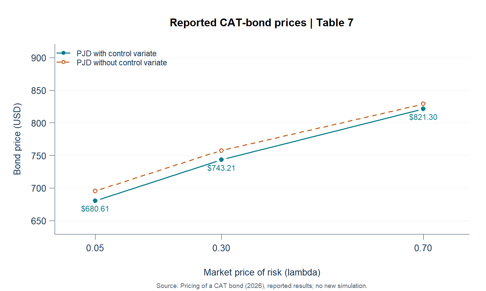
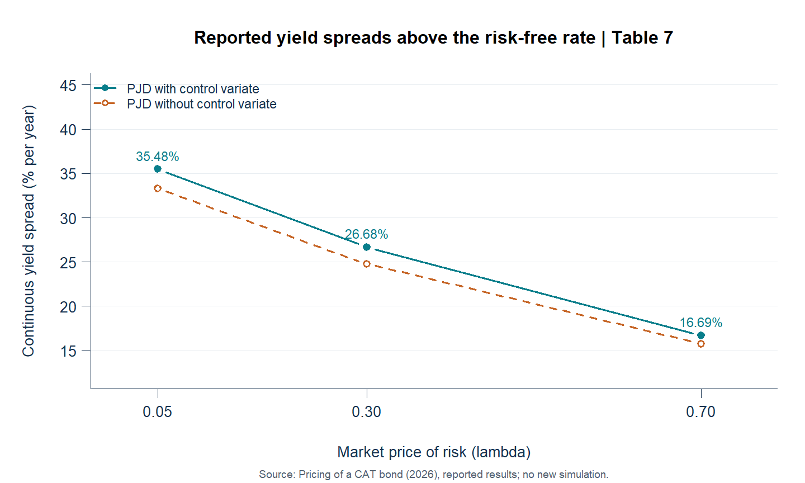
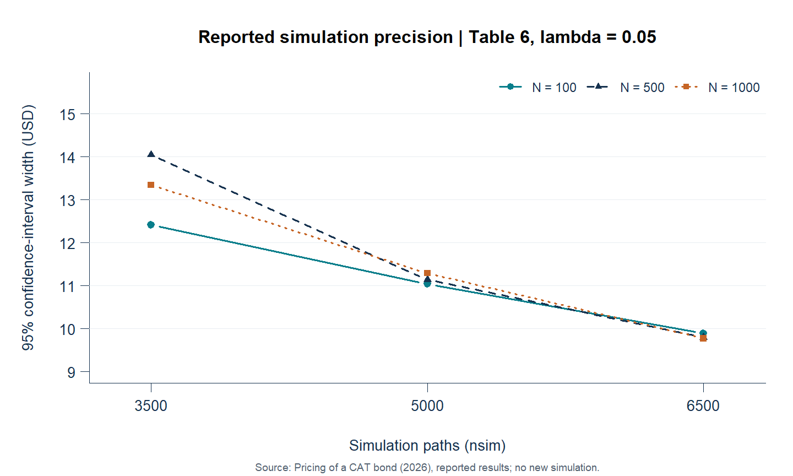
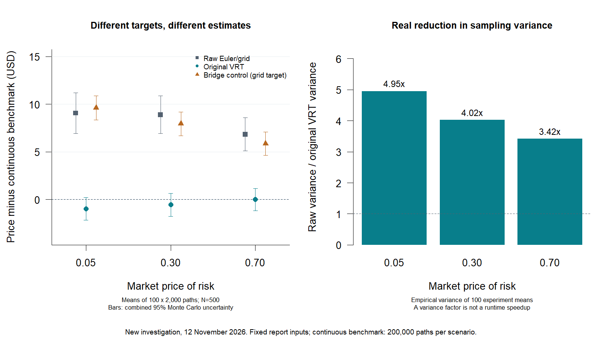

# Catastrophe Bond Pricing with Jump-Diffusion and Monte Carlo Simulation

**How can hurricane-season risk be transferred to investors, and how does the assumed risk adjustment affect its price?** This R research project models a principal-at-risk catastrophe bond linked to the North Atlantic **Accumulated Cyclone Energy (ACE)** index. It connects physical climate risk, insurance risk transfer and quantitative valuation through a Poisson jump-diffusion model and Monte Carlo simulation.

**Pim van den Bos** · Financial Engineering & Management master's student · University of Twente

Academic modeling project based on [*Pricing of a CAT bond*, 30 March 2026](reports/Pricing_CAT_Bond.pdf). The bond is hypothetical: there are no observed CAT-bond quotes or commercial market calibration.

[Reproduction and estimator investigation](docs/reproduction.md) · [Research methodology](docs/methodology.md) · [Maintained R code](R/pricing.R) · [Code provenance](docs/code_provenance.md) · [Reported tables](results/reported/) · [Software checks](docs/execution_status.md)

## The project in one minute

1. Study historical North Atlantic ACE and calculate annual log returns.
2. Estimate a Poisson jump-diffusion model using the recovered original likelihood; examine epsilon and optimization starting points.
3. Compare annual ACE and Yahoo S&P 500 adjusted-price log returns using Pearson and Spearman tests.
4. Price a USD 1,000 bond whose principal is lost if the simulated ACE path reaches 200 within one year.
5. Pair jump-diffusion and GBM paths, apply a GBM control variate, and study simulation precision and risk-adjustment scenarios.

**Skills demonstrated:** R, stochastic modeling, maximum-likelihood workflow, Monte Carlo valuation, variance reduction, parallel computing, financial risk interpretation, data provenance and reproducible software checks.

## Selected findings from the report

| Market price of risk | PJD price with VRT | Continuous yield spread with VRT | PJD price without VRT | Spread without VRT |
| ---: | ---: | ---: | ---: | ---: |
| 0.05 | $680.61 | 35.48% | $695.59 | 33.30% |
| 0.30 | $743.21 | 26.68% | $757.54 | 24.77% |
| 0.70 | $821.30 | 16.69% | $829.06 | 15.75% |

Table 7, with 500 time steps and 6,500 paths. Spreads are annual **continuously compounded yield spreads above the 3% risk-free rate**: `-log(price / face_value) / maturity - risk_free_rate`. They are not coupons or guaranteed realized returns.



Under this implementation, increasing the market-price-of-risk parameter lowers the adjusted ACE drift (`mu - lambda * sigma`), reduces trigger probability and raises bond price. These are sensitivity assumptions, not risk premia calibrated from traded bonds.

The report finds no statistically significant linear or rank relationship between annual ACE and S&P 500 returns: **Pearson 0.0514, p = 0.6659**, 95% interval **[-0.1808, 0.2782]**, with **73 reported pairs**; **Spearman 0.0867, p = 0.4660**. This motivates investigating diversification, but does not prove independence, zero beta or absence of tail dependence. The reported optimum log-likelihood is approximately **-208.94**.

<details>
<summary>Reported yield spreads and simulation confidence-interval widths</summary>





These figures use transcribed Tables 6-7, not newly simulated results. [SVG and PNG files](assets/figures/) and [R generation script](scripts/figures.R) are included.

</details>

## Run it

Use **R 4.5.3** for the checked environment (code requires R >= 4.1). Run commands from the repository root. Pricing, tests and report-based figures need **only base/recommended R**, with no data download or package installation.

```sh
git clone https://github.com/Pimvdbos/cat-bond-pricing.git
cd cat-bond-pricing
Rscript --vanilla tests/run_tests.R
Rscript --vanilla scripts/price.R small 1
Rscript --vanilla scripts/figures.R
```

The small example uses the reported model/bond parameters with **50 steps and 100 paths**, printing all four Appendix C prices and spreads: PJD with VRT, PJD without VRT, GBM simulation and GBM formula. It is a software demonstration, not a precise research estimate. Outputs, configuration and session metadata go to a new directory under `results/generated/`.

The same example interactively:

```r
source("R/pricing.R")
config <- load_config()
config$N <- 50L
config$nsim <- 100L
price_bond(config, workers = 1)$summary
```

For the three research scenarios and the complete 3-by-3 sensitivity grid:

```sh
# workers=2 uses portable PSOCK workers; use 1 for serial execution
Rscript --vanilla scripts/price.R full 2
Rscript --vanilla scripts/price.R sensitivity 2
```

`full` runs lambda = 0.05, 0.30, 0.70 with N=500 and nsim=6500. `sensitivity` runs all N = 100, 500, 1000 and nsim = 3500, 5000, 6500 at lambda=0.05. Edit [config/default.R](config/default.R) to inspect or change inputs. Workers are cleaned up when a run exits.

## Historical data and estimation

Install the optional dependencies listed in [DESCRIPTION](DESCRIPTION); [recorded package versions](config/tested-packages.csv) document the actual checked environment. The installation script resolves missing packages from CRAN; this is not a frozen dependency lockfile.

```sh
Rscript --vanilla scripts/install.R
Rscript --vanilla scripts/acquire_data.R ace
Rscript --vanilla scripts/acquire_data.R sp500
Rscript --vanilla scripts/analyze.R initial
Rscript --vanilla scripts/analyze.R correlation
# Original likelihood with recovered helpers
Rscript --vanilla scripts/analyze.R estimate
```

Acquisition succeeded on **11 November 2026** for both sources. The recovered ACE file contains 172 levels in 1851-2022 and 171 annual log returns; the lost original file cannot be assumed identical. Yahoo adjusted prices cover 3 January 1950 to 30 December 2022, producing 73 annual returns under the original partial-first-year convention. See [data instructions, checksums and coverage](data/README.md) for caches, manual files and provenance. Raw downloads and market-data caches are excluded from Git.

**Recovered original helpers:** `functions.R` and `LL.R` are now available in [original/teaching/](original/teaching/). The original Poisson-normal mixture likelihood is restored with annual ACE returns, `maxLik` BHHH, 1,000 iterations and ten seed-123 perturbed starts. No required dependency remains missing. Teaching example data and bond terms are not used; pricing keeps the report's fixed parameters.

## Reproduction and independent investigation (12 November 2026)

Tables **1, 3, 4, 5, 6 and 7** reproduce at their published numerical precision (Table 5 is the contract specification). Table **2** is close but not identical at the published rounding; all discrepancies are recorded, rather than adjusting the estimates to match. Both Pearson and Spearman narrative results reproduce. Original supplied findings remain untouched under `results/reported/`.

The variance-reduction technique reduces sampling variance, but it also shifts the target because grid-monitored GBM payoffs are centered at a continuous-monitoring formula. A separate investigation measures this effect using repeated experiments, an exactly centered GBM bridge control and a continuous-PJD benchmark. See the [results and interpretation](docs/reproduction.md) before treating a narrower interval as evidence of a more accurate valuation.



```sh
Rscript --vanilla scripts/reproduce.R 2
Rscript --vanilla scripts/compare_report.R
Rscript --vanilla scripts/estimation_diagnostics.R
Rscript --vanilla scripts/investigate.R 2 100 2000
Rscript --vanilla scripts/continuous_benchmark.R 200000 2
Rscript --vanilla tests/recovery_tests.R
```

Full runs create separate directories under `results/generated/`; curated publication snapshots and their configurations are committed there. Diagnostic estimators are clearly separated from the faithful report implementation.

## Navigate the repository

| Location | Purpose |
| --- | --- |
| [reports/](reports/) | Unchanged 24-page source report |
| [original/](original/) | PDF transcriptions of Appendices A-C plus recovered original teaching files |
| [R/](R/) and [scripts/](scripts/) | Maintained functions and executable workflows |
| [config/](config/) | Reported model/bond defaults and tested optional package versions |
| [results/reported/](results/reported/) | Tables 1-7, narrative statistics, definitions and published rounding |
| [results/generated/](results/generated/) | Local fresh-run outputs, separate from supplied findings |
| [docs/methodology.md](docs/methodology.md) | Model, control variate, statistical interpretation and limitations |
| [docs/code_provenance.md](docs/code_provenance.md) | Listing-to-code mapping and reconstruction changes |
| [tests/](tests/) and [.github/workflows/](.github/workflows/) | Offline software checks using artificial fixtures |

## Assumptions, limits and execution status

The modeled payoff is discounted terminal principal, monitored for a threshold breach on a simulated grid. The implementation retains the report's Euler discretization and continuous GBM analytical control; discretization and model uncertainty remain. Historical annual ACE dynamics are used to model a within-year path; this is an academic assumption, not a physically monotone seasonal accumulation model. Historical climate distributions may not describe future risk.

**Parametric basis risk:** basin-wide ACE and an insurer's actual insured losses need not coincide. A high ACE season may trigger principal loss with little damage to the insurer, while severe insured losses may occur without the ACE trigger.

Local software checks, recovered-code equivalence tests, full table reproduction and independent estimator experiments have been completed on R 4.5.3/Windows. Reproduction is not a claim of exact agreement in every table: Table 2 differs slightly. See [execution details](docs/execution_status.md) and the [investigation](docs/reproduction.md).

## Attribution and disclosure

The report credits the supplied teaching-code foundations `part2_cat_est.R` and `part4_cat_price_vrt.R`. Their authors and license are not identified in the supplied material; no attribution or license has been invented. Data credit: HURDAT/NOAA, processed by Our World in Data; Yahoo Finance via `quantmod` for `^GSPC`. The report retains its full bibliography. See [rights and attribution](RIGHTS.md).

Original **Use of AI Statement**, preserved verbatim:

> Claude and ChatGPT were used to assist in structuring the argument and identifying relevant data points from public sources. All analytical conclusions, interpretation and final text are written by myself.

Repository packaging, transcription repairs, maintained software and documentation were subsequently assisted by OpenAI Codex. This packaging disclosure is separate from the report's original statement.
