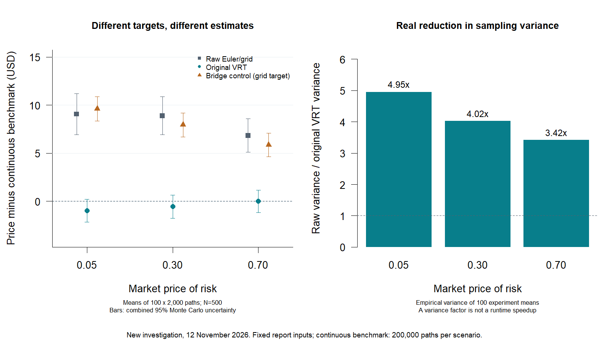

# Reproduction and independent estimator investigation

**12 November 2026 — recovered original teaching helpers; R 4.5.3 on Windows.** The supplied report and `results/reported/` are unchanged. This follow-up restores the original MLE likelihood, reruns the ACE workflow and independently examines the pricing estimator. It does not substitute teaching example data, monthly time steps, teaching bond terms or newly estimated pricing parameters.

## What reproduces

| Table | Result |
| --- | --- |
| 1: epsilon sensitivity | All jump/diffusion counts and initial intensities match published rounding. |
| 2: MLE parameters/inference | Close, but **not an exact rounded reproduction**. Full differences are retained below and in machine-readable comparisons. |
| 3: ten optimization starts | All ten reach -208.9359 at four decimal places. |
| 4: Pearson test | All entries reproduce at published precision; 73 pairs and Spearman 0.0867 / p=0.4660 also reproduce. |
| 5: bond terms | All six configuration values agree. This is a specification check, not an empirical estimate. |
| 6: sensitivity grid | All 9 rows reproduce in price, CI endpoints and width at two decimal places. |
| 7: price/spread scenarios | All prices and spreads reproduce at their published precision. |

The [reproduction snapshot](../results/generated/reproduction-2026-11-12/) contains full-precision outputs, [cell-by-cell comparisons](../results/generated/reproduction-2026-11-12/comparison.csv), configuration, data hashes and session information. The ACE and Yahoo files are the actual cached downloads from 11 November, not new downloads or assumed originals: 172 ACE levels/171 returns (1851-2022), 73 paired returns (1950-2022), with Yahoo's partial first annual period preserved. No rows were removed to force the report's narrative sample count.

Of Table 2's 20 numerical entries (estimate, SE, t and p for five parameters), 9 match at published precision and 11 differ. Every comparison is available in the CSV; the inequality p<0.001 is compared as an inequality, not as an exact value.

### MLE details and differences

The restored `LL.R` uses `k=0:50`, annual `delta.t=1`, and normal conditional log returns with mean `(mu-sigma^2/2)*delta.t+k*kv` and variance `sigma^2*delta.t+k*delta^2`. Original code is preserved byte-for-byte. BHHH uses the report's initialization, 1,000-iteration limit and ten `set.seed(123)` Uniform(0.5,1.5) starting multipliers.

| Parameter | Report estimate | Re-estimate | Report SE | Re-estimated SE |
| --- | ---: | ---: | ---: | ---: |
| mu | 0.196 | 0.196470 | 0.094 | 0.093759 |
| sigma | 0.660 | 0.660524 | 0.076 | 0.075679 |
| delta | 1.550 | 1.552503 | 0.884 | 0.889211 |
| lambda.p | 0.135 | 0.135046 | 0.142 | 0.141620 |
| kv | 0.202 | 0.201292 | 0.452 | 0.454155 |

The primary fit's log-likelihood is -208.93593705, with 17 iterations and code 8 (successive function values within relative tolerance). All ten restarts return code 8, within about 1.4e-6 in log-likelihood. Similar objective values do not prove a global maximum or identical parameter estimates. NaN warnings were produced during some unconstrained trial evaluations (51 each on restarts 4, 5 and 7); they are recorded rather than hidden as unexplained failures. Final fits are finite. The original likelihood does not impose a positive-intensity parameter transform; negative trial intensities are invalid. Its squared scale parameters also mean sign symmetry is not resolved by the likelihood itself.

A separate cutoff diagnostic gives the same displayed log-likelihood for k maxima 10, 25, 50 and 100; the omitted Poisson mass beyond 50 at the fitted intensity is about 2.55e-111. A tighter stopping-tolerance check moves estimates slightly while scarcely changing the objective. This demonstrates sensitivity to optimizer stopping on a locally flat surface; it does **not** establish the precise cause of every discrepancy with the lost original run. The original software environment and research data file are unavailable. No optimization settings or data were tuned to force Table 2, and its reported values remain untouched.

## The key estimator distinction

Let **X** be the report's Euler PJD/grid-monitored discounted principal, **Y** its paired Euler GBM/grid payoff, and **c** the continuous-monitoring GBM formula. The report calculates:

```text
estimate = mean(X) - beta_hat * (mean(Y) - c)
beta_hat = sample_cov(X,Y) / sample_var(Y)
```

For a fixed coefficient beta, its expectation is `E[X] - beta*(E[Y]-c)`. Variance reduction preserves `E[X]` only when the control is centered at **its own expectation**. Here c is not exactly E[Y]: the formula continuously monitors a GBM, while Y discretizes its dynamics and checks the barrier only at the simulation grid. With a fitted coefficient, finite-sample coefficient effects also enter; fitting beta on the same paths does not repair the nonzero control mean.

The GBM formula itself is consistent with the reflection principle. Write `b=log(K/I0)`, `m=mu-lambda*sigma-sigma^2/2`, and `v=sigma^2*T`. Continuous hit probability is

```text
Phi((m*T-b)/sqrt(v)) + exp(2*m*b/sigma^2)*Phi((-m*T-b)/sqrt(v)).
```

This equals the appendix's formula algebraically. Numerical integration of conditional Brownian-bridge survival independently agrees for all three risk scenarios. The problem is **which payoff expectation is used to center the control**, not a demonstrated sign error in the printed formula.

### Selected report run, N=500 / nsim=6500 / lambda=0.05

The faithful run reproduces PJD $695.5855 without VRT and $680.6104 with VRT. The paired GBM mean is $726.0426, versus formula $709.7884: a $16.2542 gap. Multiplying that sample gap by the fitted coefficient gives the entire $14.9751 downward adjustment. Its reduced standard error is $2.4985, compared with $5.4239 unadjusted. These are different sample means and smaller Monte Carlo dispersion; neither fact alone proves accuracy for a specified target.

## Repeated experiments

[Investigation outputs](../results/generated/investigation-2026-11-12/) use **100 repetitions of 2,000 paths** for each of five settings: N=100/500/1000 at lambda=0.05, plus N=500 at lambda=0.30/0.70. All model and contract parameters remain those of the report. Repetition seeds follow recovered teaching part 5: `set.seed(nsim*p+j)`. Repeated configurations deliberately share seeds for paired comparisons; they are not independent evidence across settings. Within a setting, distinct seeds produce the deterministic pseudorandom experiments.

The independent diagnostic implementation draws the same normals/Poisson counts/jump sizes but constructs Euler paths with vectorized cumulative products. It additionally computes exact log-GBM endpoints and the conditional continuously monitored GBM payoff using Brownian bridges. Conditional on endpoints below b, interval survival is `1-exp(-2*(b-x)*(b-y)/(sigma^2*dt))`; survival probabilities multiply over intervals. Endpoint crossings have zero survival. The bridge payoff has analytical mean c, avoiding the grid-control centering error.

A two-fold cross-fitted coefficient is estimated on the opposite half of the paths before adjusting each held-out half. Each coefficient is therefore independent of the payoffs it adjusts (under the Monte Carlo independent-path model). This diagnostic targets **the original Euler/grid PJD payoff expectation**, with an exactly centered control. It is not silently substituted into report pricing. Experiment-level variability is measured empirically; no ordinary iid SE is incorrectly assigned to the cross-fitted observations within one experiment.

| N | lambda | Raw mean | Original VRT mean | Cross-fitted bridge-control mean | Original variance-reduction factor |
| ---: | ---: | ---: | ---: | ---: | ---: |
| 100 | 0.05 | $701.70 | $680.89 | $701.75 | 5.77 |
| 500 | 0.05 | $689.59 | $679.55 | $690.14 | 4.95 |
| 1000 | 0.05 | $687.91 | $679.93 | $687.27 | 5.67 |
| 500 | 0.30 | $751.02 | $741.58 | $750.07 | 4.02 |
| 500 | 0.70 | $826.08 | $819.24 | $825.10 | 3.42 |

The factor is **empirical variance of raw experiment means divided by empirical variance of original VRT experiment means**, not a runtime speedup. It is estimated from only 100 experiments. At N=500/lambda=0.05 the original VRT shifts the mean by **-$10.03**, paired SE **$0.88**; the exactly centered bridge-control estimate differs from raw by **+$0.55**, paired SE **$0.85**. Thus a large target shift accompanies real variance reduction. The report's single-run $14.98 shift also includes sample fluctuation.

### Where the GBM gap comes from

For lambda=0.05, the mean exact-grid GBM payoff minus the bridge payoff is $23.40 at N=100, $11.60 at N=500 and $8.13 at N=1000. Euler-minus-exact-grid effects are -$0.76, -$0.12 and -$0.22 respectively. The dominant measured component is missed between-grid barrier crossing. Bridge-minus-formula differences are within the Monte Carlo uncertainty of these runs. The analysis separates the monitoring gap from sampling error instead of labeling every GBM/formula difference discretization bias.

The measured within-experiment adjusted SEs also agree reasonably with empirical repetition SDs: for N=500/lambda=0.05, RMS reported SE is $4.50 versus empirical SD $4.55. This supports the reported **sampling-dispersion calculation**, not coverage of an incorrectly centered target. Confidence-interval coverage for an unknown exact Euler/grid PJD expectation has not been established.

Euler PJD paths can become negative: 97 of 200,000 paths at N=500/lambda=0.05 did so, versus 319 at N=100 and 46 at N=1000. These are diagnostics of the supplied scheme, not historical ACE observations. No clipping was introduced. Multi-jump steps also occur and retain the original sum-of-relative-jumps convention, rather than a product.

## Independent continuous-PJD benchmark

To distinguish the grid payoff from an intended continuous-time target, [a separate benchmark](../results/generated/continuous-benchmark-2026-11-12/) simulates **200,000 paths per lambda** of the continuous multiplicative PJD implied by the recovered likelihood. It samples exact Poisson event times, normal log-jump sizes, exact log-diffusion endpoints between jumps, and integrates between-endpoint barrier crossings with Brownian bridges. Post-jump threshold hits are included. It uses the same `mu-lambda*sigma` adjustment, the same physical jump intensity and all report bond terms; no compensator is added.

This removes Euler/time-grid approximation **for this continuous model**, but retains Monte Carlo error and is not an analytical CAT-bond price. A paired continuous GBM payoff with **fixed coefficient 1** provides an exactly centered control, without fitted-coefficient bias. The three seed ranges (11,000,001 onward, 12,000,001 onward, 13,000,001 onward) are distinct from the repeated-grid experiment ranges.

| lambda | Continuous-PJD estimate | Monte Carlo SE | 95% Monte Carlo interval |
| ---: | ---: | ---: | ---: |
| 0.05 | $680.53 | $0.41 | [$679.72, $681.33] |
| 0.30 | $742.12 | $0.42 | [$741.30, $742.95] |
| 0.70 | $819.24 | $0.42 | [$818.41, $820.06] |

The original VRT repeated means are compatible with these continuous-model estimates within combined Monte Carlo uncertainty at all tested settings. This is evidence that the original adjustment compensates much of the barrier-monitoring effect **for these parameters**. It does not establish exact unbiasedness for continuous PJD, universal cancellation of discretization errors, or commercially calibrated prices. Unadjusted and exactly centered grid-control estimators target a different discretized payoff expectation; they should not be described as inferior simply because they are farther from a continuous-model benchmark.



## Practical conclusions

* The appendix reconstruction was faithful; recovered pricing kernels confirm it, and Tables 6-7 reproduce.
* The original variance reduction genuinely reduces sampling variability, but is not an unbiased control-variate estimator of the **Euler/grid payoff** when centered using the continuous GBM formula.
* As a continuous-time approximation it performs well in the tested cases, with no statistically resolved residual discrepancy from the independent continuous-PJD benchmark. Monte Carlo agreement is evidence, not proof.
* The original adjusted standard error measures dispersion around its estimator's expectation. It does not include discretization, parameter, climate, or calibration uncertainty.
* No pricing default or reported result has been changed. Alternative estimators are explicitly diagnostic and their distinct targets are documented.

## Re-run and inspect

See the [README commands](../README.md#reproduction-and-independent-investigation-12-november-2026). `scripts/compare_report.R` records full-precision differences and matches at published rounding. `scripts/snapshot_results.R` curates aggregate outputs without raw market data or serialized estimation environments. `scripts/investigation_figures.R` regenerates the investigation figure from committed snapshots without simulation or network access.

`tests/recovery_tests.R` checks the original parts 3/4/5 and both Appendix C kernels against maintained paths, the likelihood's zero-jump limit, diagnostic path equivalence, continuous zero-jump/zero-loss behavior and numerical integration of the GBM benchmark. The restored workflow has no missing required helpers. Teaching-only optional dependencies and source issues are listed in [the recovered-file inventory](../original/teaching/README.md).

The continuous Brownian-bridge diagnostic uses the conditioning approach described by P. V. Shevchenko, [*Addressing the bias in Monte Carlo pricing of multi-asset options with multiple barriers through discrete sampling*](https://arxiv.org/abs/0904.1157), Journal of Computational Finance 6(3), 2003. The code and numerical findings above are newly generated for this investigation; they are not additional claims attributed to the original report.
